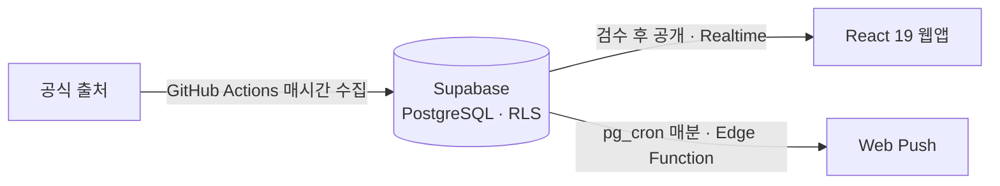
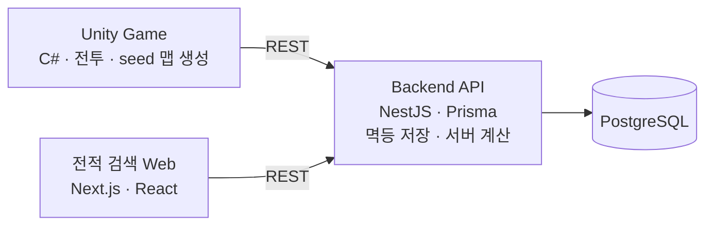

## 👋 About Me

**네트워크가 끊겨도 멈추지 않는 앱을 만드는 프론트엔드 개발자 김영욱입니다.**

- 건물 안전진단 현장용 React PWA + Flutter 하이브리드 앱을 **프론트엔드 1인**으로 개발·운영했습니다.
- IndexedDB 로컬 저장, 동기화 큐, 계정별 데이터 격리, Service Worker 캐싱, 인증 흐름까지 **오프라인 우선 구조**를 라이브러리 없이 설계했습니다.
- 지금은 공연 알림 서비스 **encore.**를 혼자 개발·운영하며 PR 단위로 검증하고 배포합니다.
- 문제는 감이 아니라 **측정**으로 찾고, 해결한 문제는 테스트·규칙 문서·AI 스킬로 남겨 반복되지 않게 합니다.

## 🎮 Now Building

### [encore.](https://github.com/yeonguk0201/Concert_finder) · 1인 개발·운영 · 2026.10 ~ 진행 중

> 좋아하는 밴드의 국내·내한 공연과 예매 일정을 모아 보고, 동의한 사용자에게 웹 푸시로 알려주는 모바일 대응 웹앱
> 공식 출처 수집 → 검수 → 공개 → 알림까지 기획·디자인·프론트·DB·운영을 혼자 맡고 있습니다.

- **RLS 기반 접근 설계**: 공개 카탈로그는 승인 항목만, 찜·일정·알림 기기는 본인 행만
- **중복 없는 알림**: 발송 직전 재조회, 유일 키, 404/410 무효화·429/5xx 재시도, 불명확한 결과는 재전송하지 않고 격리
- **PR 단위 개발**: 작업 브랜치 → dev → main, PR마다 목적·변경·검증·제한 사항 기록 (커밋 259 · PR 64 · 테스트 220+)

`React 19` `TypeScript` `Vite` `Supabase` `Edge Functions` `pg_cron` `Web Push` `GitHub Actions` `Vitest` `PGlite`

### [TrickalFanGame](https://github.com/yeonguk0201/Trickal_FanGame) · 1인 개발 · 2026.08 ~ 진행 중

> 트릭컬 IP 기반 2D 로그라이크 팬게임(비상업) + 플레이 기록을 보여주는 전적 검색 웹
> 게임 → API → DB → 웹까지 데이터 흐름 전체를 혼자 설계·구현하고 있습니다.

- **재전송해도 한 번만 저장되는 API**: Run 고유 ID + 유니크 제약 + 요청 지문, Serializable 트랜잭션
- **seed로 재현되는 맵 생성**: 같은 seed면 층·방·적 구성이 동일 → 버그를 같은 조건에서 재현
- **AI 결과물을 코드로 검증**: Unity 불변조건 검증기 130개, Jest 테스트 108개, 커밋 전 검사 · `/ship` 스킬 · main 보호 훅

`Unity 6` `C#` `NestJS` `Prisma` `PostgreSQL` `Next.js 16` `React 19` `Jest` `Vitest` `Claude Code`

## 💼 Experience

### 이안이앤씨 · 프론트엔드 개발자 · 2026.01 ~ 2026.08

> 건물 안전진단 현장 조사 앱 **EAN Site**: 지하층·기계실처럼 네트워크가 불안정한 현장을 위한 오프라인 우선 도면 조사 PWA
> 팀 구성: 백엔드 1 · 프론트엔드 1(본인). 클라이언트 전체(React 웹앱 + Flutter 앱) 개발·운영과 UI 디자인 담당

- 입력은 즉시 **IndexedDB**에 저장하고, 서버 요청은 **동기화 큐**에서 병합·재시도 후 순차 전송 (임시 UUID → 서버 ID 재매핑)
- fetch 계측으로 원인을 찾아 로그인 초기 API 호출 **7,488회 → 56회 (-99.3%)**, 누적 요청 시간 -99.9%
- 토큰 만료 + 오프라인 복귀 시 큐 데이터가 사라지던 **경쟁 조건** 해결, 한 기기 다계정 환경의 **데이터 노출** 차단
- 15개 조사 유형을 공통 핀 모델로 설계, 블루투스 강도 측정기 연동, Flutter JS 브릿지, SSE 보고서 미리보기
- CLAUDE.md 규칙 문서, 반복 작업 스킬화, `vitest related` 자동 실행 훅으로 AI 작업 결과 검증

`React 18` `TypeScript` `Vite` `Zustand` `IndexedDB` `Workbox(PWA)` `Flutter` `Tailwind CSS` `Radix UI` `Vitest`

## 🛠 Skills

**Frontend · Offline**

    
 
     

**Mobile · Game**

  

**Backend · Infra · Test**

      

**Tools · AI**

   

<b>📁 이전 학습 프로젝트</b> (엘리스 SW 트랙 · 개인 학습)

| 프로젝트 | 설명 | 기술 |
|---|---|---|
| [멍멍빌리지](https://github.com/yeonguk0201/MongMongVillage-BE) | 애견인 커뮤니티 & 애견카페 리뷰 (5인 팀) · 10개 팀 중 최우수상 | React, React Query |
| [꾸부기](https://github.com/yeonguk0201/GGuboogi) | AI 맞춤 스트레칭 루틴 모바일 웹 | Next.js 15, SSE |
| [Min:i](https://github.com/Memory-album/memory-FE) | 그룹 단위 추억 공유·보관 플랫폼 | Next.js, Zustand |
| [YelpCamp](https://github.com/yeonguk0201/YelpCamp) | 캠핑장 정보 & 리뷰 사이트 (개인, 풀스택) | Express, MongoDB |

## 📫 Contact

- Email: yeonguk0201@gmail.com
